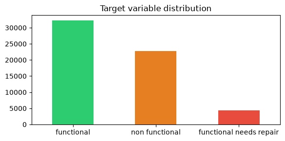
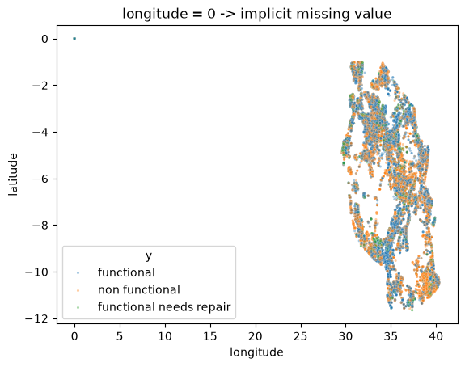
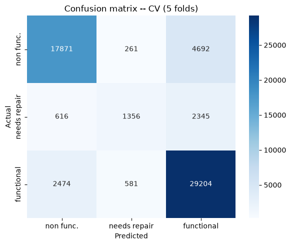

# Pump It Up: Data Mining the Water Table (DrivenData)


A multiclass classification pipeline that predicts the operating condition of water
pumps across Tanzania, built for DrivenData's [Pump It Up: Data Mining the Water
Table](https://www.drivendata.org/competitions/7/pump-it-up-data-mining-the-water-table/page/23/)
competition. The dataset is a genuinely messy real-world problem: heavy implicit
missingness, very high-cardinality categoricals, and a sharp class imbalance.

---

## Results

| Metric | Value |
|---|---|
| **Cross-validation accuracy** (5-fold, leakage-free) | **0.8153 ± 0.0036** |
| **DrivenData leaderboard accuracy** | **0.8203** |
| **Leaderboard position** | **2489 / 20,171** (~top 12%) |

<p align="center">
  
  
  
</p>
<p align="center"><em>Class imbalance in the target · implicit missing values hiding as <code>longitude = 0</code> · final cross-validation confusion matrix.</em></p>

---

## Approach

Four pillars drive the modeling and engineering strategy, aimed at squeezing signal
out of the data without compromising statistical rigor.

### 1. Exploratory Data Analysis (EDA) and cleaning

- Detecting and handling implicit missing values encoded as zeros in geographic or
  temporal columns (`longitude`, `gps_height`, `construction_year`).
- Dropping redundant columns (`payment_type` is identical to `payment`;
  `quantity_group` duplicates `quantity`).
- Controlled imputation for structural columns such as `scheme_management` and
  `installer`.

### 2. Leakage-free feature engineering

- New seasonal (month) and temporal (pump age, computed from the record date) features.
- **Target-ratio encoding**, implemented as a `fit_target_features()` /
  `transform_target_features()` pair: thresholds are learned exclusively from the
  training data of each fold and then applied to that fold's validation split.
- **Leakage prevention:** the failure-rate-based features (`good_region`,
  `bad_funders`, `lga_func_tier`) are computed using only the training half of each
  cross-validation fold, so the validation split is never contaminated.

### 3. Modeling strategy (soft-voting ensemble)

A `VotingClassifier` with soft voting combines three models, each tuned beforehand
with `GridSearchCV` / `RandomizedSearchCV`:

- **Random Forest** (weight = 3) — the strongest individual model on this dataset.
- **LightGBM** (weight = 2) — handles complex categoricals well, trains fast.
- **XGBoost** (weight = 2) — complements the ensemble with a different inductive bias.

### 4. Validation and tracking

- Stratified 5-fold cross-validation (`StratifiedKFold`) to preserve the class
  distribution.
- Experiment lifecycle managed with **MLflow** (metrics, parameters, trained models).

---

## Lessons learned / what I'd do differently

- **Target-ratio features are powerful but risky.** They gave a real accuracy boost,
  but only after rebuilding them as per-fold `fit`/`transform` functions — an earlier
  version leaked validation information into training and overstated CV accuracy.
- **A soft-voting ensemble is a strong, low-effort ceiling.** It beat every individual
  model, but a stacking model on top of the three models' predictions would likely
  add another point or two of accuracy.
- **High-cardinality categoricals deserve more than `LabelEncoder`.** `installer` and
  `funder` have hundreds of rare values; target encoding or frequency bucketing would
  probably help the minority *functional needs repair* class specifically.
- **Next steps:** native categorical support in LightGBM/XGBoost instead of
  `LabelEncoder`, geospatial features (distance to nearest functional pump), and a
  stacked meta-model on top of the current ensemble.

---

## Installation and usage

The project uses **relative paths**, so it runs both locally and on Google Colab
without changing any code.

### 1. Clone the repository

```bash
git clone https://github.com/inigoochoa/pump-it-up-competition.git
cd pump-it-up-competition
```

### 2. Install dependencies

```bash
pip install -r requirements.txt
```

### 3. Download and organize the data

Per DrivenData's policy, the data files are **not included** in this repository.

To reproduce the results:

1. Register and sign in on DrivenData.
2. Download the official competition datasets.
3. Create the following folder structure:

```text
pump-it-up-competition/
├── data/
│   ├── training_set_values.csv
│   ├── training_set_labels.csv
│   └── test_set_values.csv
├── notebooks/
│   └── pump_it_up_ensemble.ipynb
├── .gitignore
├── LICENSE
├── README.md
└── requirements.txt
```

### 4. Google Colab

If you run the notebook from Google Colab:

- The notebook detects Colab automatically and mounts Google Drive.
- Keep the `data/` folder under `pump-it-up-competition/` in your Drive so the
  relative paths resolve correctly.

---

## Tech stack

- **Language:** Python 3
- **Data manipulation:** pandas, numpy
- **Visualization:** matplotlib, seaborn
- **Machine learning:** scikit-learn, XGBoost, LightGBM
- **Experiment tracking:** MLflow

---

## Author

**Íñigo Ochoa**

[GitHub](https://github.com/inigoochoa) · [LinkedIn](https://www.linkedin.com/in/inigo-ochoa-gil)

---

## License

This project is licensed under the [MIT License](LICENSE).
